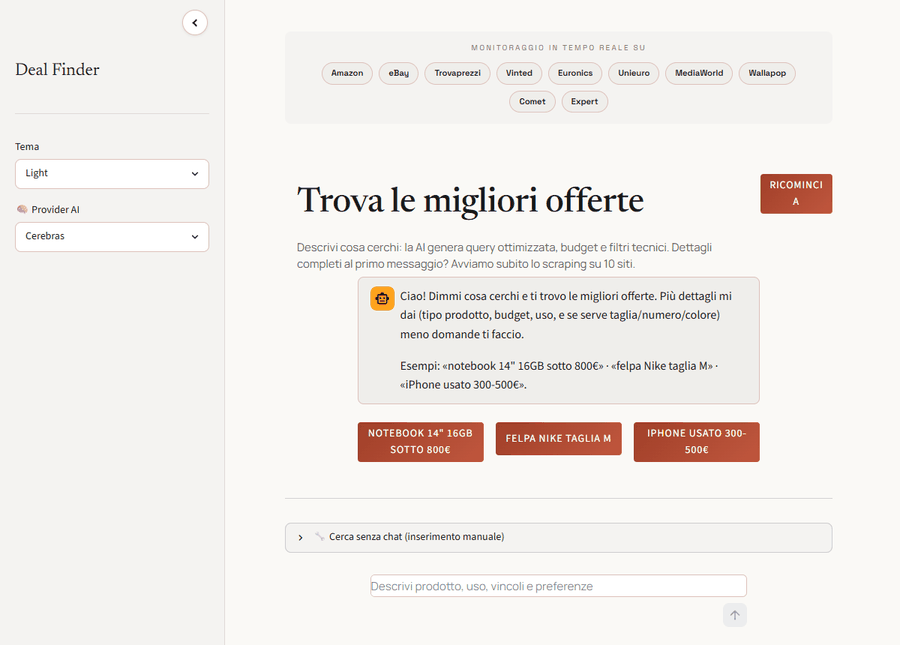
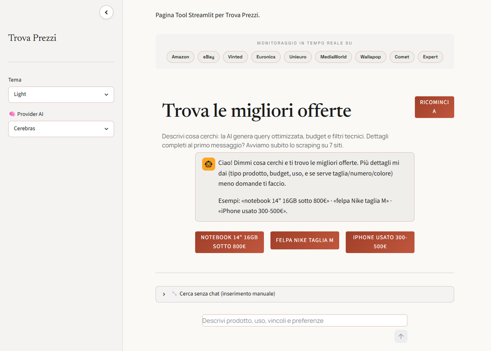
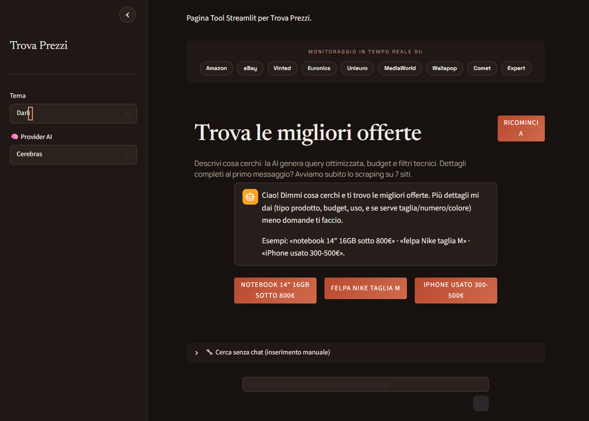
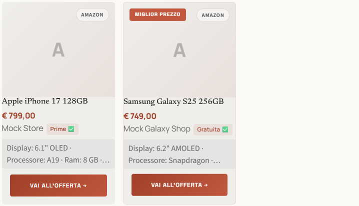

# 🛒 Deal Finder

> Price comparison for Italian shops and marketplaces, with optional autonomous multi-product search, official Codex accounts, optional Claude and explicitly selected API connections.

[](https://github.com/DiegoRiccardi1234/deal-finder/actions/workflows/ci.yml)


[](https://github.com/DiegoRiccardi1234/deal-finder/releases/latest)

[](https://github.com/astral-sh/ruff)


**📦 Download:** [latest release](https://github.com/DiegoRiccardi1234/deal-finder/releases/latest) — choose `DealFinder-organized-windows.zip` for a new installation: unzip, open the root `DealFinder.exe`, no Python or terminal window. Existing installations use the in-app updater and its compatible `DealFinder-windows.zip` asset. See [layout and migration](docs/WINDOWS-LAYOUT.md).

**[🇬🇧 English](#-english) · [🇮🇹 Italiano](#-italiano)**

<p align="center">
  
</p>

<p align="center">
  
  &nbsp;
  
</p>

<p align="center">
  
</p>

---

## 🇬🇧 English

Describe what you want in plain language — the AI turns it into an optimized query, budget and technical filters, then scrapes up to 14 sources in parallel and ranks the results. A built-in chat recommends which product to buy and why.

### ✨ Features

- **Autonomous multi-product search** — up to ten products, one consolidated budget question, progressive saved results, cancellation and grounded advice.
- **Native assistants and MCP** — isolated Codex accounts, optional Claude, explicit planning/analysis/advice routes, and ten local MCP tools sharing the application's data owner. MCP collection does not invoke models.
- **Conversational search** — an LLM extracts query, budget and hardware specs from a free-text request, then auto-generates a ranked top-3 recommendation.
- **Optional multi-provider AI** — Google Gemini by default, with task-specific Flash/Lite models and bounded model failover. No automatic provider changes; OpenRouter uses only healthy free endpoints.
- **Parallel sources** — aggregated, de-duplicated and price-ranked. Availability and supported conditions are reported for each search, including empty searches and cached results.
- **Watchlist** — save products and review them even before running a new search.
- **Listing checks** — explicit title warnings for empty boxes, broken items,
  deposits and monthly prices, also passed to the AI recommendation. Offers
  remain visible; a low price alone does not trigger a warning.
- **AI failure guidance** — payment, key and rate-limit errors explain the next
  step in Settings; local search preparation is disclosed when AI is unavailable.
- **Price history + alerts** — tracks the minimum price per query over time and flags new lows / below-threshold deals.
- **Persistent search cache** — disk-backed with TTL, respecting your filters and result limit. Use **Aggiorna offerte** to fetch fresh results immediately.
- **Light & dark mode**, CSV export, side-by-side comparison, Amazon price history.
- **Auto-update** — local installs check GitHub for a newer release and update with one click.

### 🌐 Sources

Scraping public sites is not a stable contract: markup changes and bot protection comes and goes. Rather than claim a headline number, here is the measured state — reproduce it yourself with `python tests/probe_scrapers.py --query "iphone 15" --budget 900`.

**Last verified: 2026-07-30** (query `iphone 15`, budget €900)

This table is a historical snapshot. The current maintenance review and dated
live results are in [the October 22 report](docs/REVIEW-2026-10-22.md).
Vinted's updated 5.1 adapter passed a live search on October 22; availability
still depends on the source and the client network.

| Source | Status | Notes |
|---|---|---|
| eBay | ✅ 40 | Browse API when `EBAY_APP_ID`/`EBAY_CERT_ID` are set; the HTML fallback gets 403 |
| Trovaprezzi | ✅ 40 | Merchant-level offers, so the shop shown is the actual seller |
| Comet | ✅ 40 | Public Algolia endpoint |
| Vinted | ✅ 38 | Second-hand only |
| Wallapop | ✅ 39 | Second-hand only |
| Euronics | ✅ 36 | Cloudflare blocks `/search`; uses the SFCC AJAX grid endpoint instead |
| Amazon | ✅ 28 | Throttles to HTTP 503 under burst — best-effort, not guaranteed |
| Unieuro | ✅ 16 | Public Algolia endpoint |
| MediaWorld | ⚠️ 1–4 | Answers, but its catalogue matches few queries |
| Expert | ⚠️ 2–10 | JSON-LD `ItemList`, thin catalogue coverage |
| AliExpress | ⚠️ 0–11 | Plain HTTP works on some runs. Off by default |
| Subito | ❌ blocked | Akamai returns 403 even under headless Playwright |
| Temu · Alibaba | ❌ blocked | Interactive CAPTCHA — no HTTP path |

Sources that cannot answer say so rather than looking empty: each search records
one of `ok` / `empty` / `blocked` / `error` / `disabled` per source, shown in the
UI's source panel. "0 results because Amazon throttled us" and "0 results because
nothing matched" are different answers, and the app now tells them apart.

A **weekly canary** ([`sources-canary.yml`](.github/workflows/sources-canary.yml))
probes the real network and opens an issue when a source stops answering. It
compares against a versioned baseline ([`tests/sources_baseline.json`](tests/sources_baseline.json))
instead of expecting everything to work, because Amazon rejects CI cloud IPs by
design and eBay needs API keys — a canary that cried wolf weekly would be ignored.
The test suite deliberately mocks the whole network, so this is the only thing
that can catch a site changing its markup.

### 🚀 Quickstart

**A. Windows bundle** — what most people want:
download `DealFinder-organized-windows.zip` from the [latest release](https://github.com/DiegoRiccardi1234/deal-finder/releases/latest), extract the entire folder, double-click its root `DealFinder.exe`. Program files live in `app`, private data in `state`. No Python or terminal window; the browser opens by itself. Select **Usa Codex per tutte le attività** in **AI e assistenti** after separately installing and authenticating the official client, or configure an API connection. Existing users should use the in-app updater; it preserves the existing layout and data. For an explicit layout migration, follow [the Windows guide](docs/WINDOWS-LAYOUT.md).

**B. From source** — the developer path:
```bash
scripts/run.bat    # Windows
./scripts/run.sh   # macOS / Linux
```
The script creates a virtualenv, installs dependencies and launches the UI on `http://localhost:8501`.

**C. Hosted** — deploy `app.py` from the repo on [share.streamlit.io](https://share.streamlit.io), then add your keys under *Settings → Secrets* (template in [`.streamlit/secrets.toml.example`](.streamlit/secrets.toml.example)).

**D. Docker** — provided, but **not exercised in CI**:
```bash
cp .env.example .env                 # then fill in your keys
docker compose -f docker/docker-compose.yml up --build
# open http://localhost:8501
```
Docker reads the keys from `.env`, **not** from `.streamlit/secrets.toml`: that path is excluded from the build context in `.dockerignore`, so the container never sees it.

### 🔑 Configuration

Version 4.3 supports native Codex accounts, optional Claude Code, named
compatible connections and local MCP clients including Hermes. Use **AI e
assistenti** for explicit routing. See [AI assistants](docs/AI-ASSISTANTS.md)
and [Windows layout and migration](docs/WINDOWS-LAYOUT.md).

API connections can use `.streamlit/secrets.toml.example` copied to `.streamlit/secrets.toml`. Everything is optional — scraping works without keys; native Codex uses its own official login. Set `AI_PROVIDER` and the key(s) of an API provider if desired; the sidebar lets you switch among configured connections.

| Provider | Secret | Get a key |
|---|---|---|
| Google Gemini (default) | `GEMINI_API_KEY` | https://aistudio.google.com |
| Groq | `GROQ_API_KEY` | https://console.groq.com |
| OpenAI | `OPENAI_API_KEY` | https://platform.openai.com |
| OpenRouter | `OPENROUTER_API_KEY` | https://openrouter.ai |
| Anthropic (Claude) | `ANTHROPIC_API_KEY` | https://console.anthropic.com |

Other settings: `APP_PASSWORD` (dashboard login), `EBAY_APP_ID` / `EBAY_CERT_ID` (eBay Browse API).

Gemini's free tier requires a project without active billing; model availability
does not identify the billing tier of a key. Limits vary by project and model.
OpenRouter is restricted to `:free` models and zero-priced healthy endpoints.
OpenAI and Anthropic require explicit selection. With no key, manual search is
available immediately. Cerebras configurations fall back to Gemini without
deleting the old saved credential or selecting a paid provider.

### 🖥️ CLI

A command-line entry point complements the web UI. `pip install -e .` exposes it as `deal-finder`:
```bash
deal-finder -q "notebook 14 16gb" -b 800 -n 5 --condizione nuovo
deal-finder -q "ssd 1tb" --export csv --output deals.csv
deal-finder -q "mouse" --provider groq        # choose the AI backend
```
Without installing, run it straight from the checkout with `python offerte_tech.py <same flags>`.
`--provider` (or the `AI_PROVIDER` env var) selects the LLM backend for the AI
features and drives the **whole engine** — CLI, orchestrator and UI alike, not
just the sidebar.

### 🧱 Architecture

```
offerte/      core engine — scrapers, orchestrator, AI, parsing, dedup, providers, cache, config
ui/           Streamlit UI — auth, search flow, cards, comparison, recommendation
app.py        entry point (page config, auth gate, render flow)
updater.py, watchlist.py, price_history.py, search_history.py   features & persistence
tests/        unit suite (monkeypatched) + Playwright E2E
```
The LLM backend is abstracted in [`offerte/providers.py`](offerte/providers.py): Gemini, Groq, OpenAI and OpenRouter share the OpenAI-compatible client; Anthropic has a thin adapter. The local knowledge base guides questions and is not an automatically generated catalogue of current products. Missing specifications stay unknown. See [`docs/ARCHITECTURE.md`](docs/ARCHITECTURE.md).

### ✅ Tests & CI

```bash
pytest tests/ -k "not playwright"     # fast offline unit + feature suite
pytest tests/                          # full suite incl. Playwright E2E
ruff check . && ruff format --check .  # lint + format
mypy offerte ui                        # type-check (required)
```
GitHub Actions runs **lint**, **type-check** and offline **tests** as required
checks, plus advisory dependency-audit and Playwright jobs. Tests cover Python
3.11, 3.12 and 3.13. See
[`SECURITY.md`](SECURITY.md) and [`CHANGELOG.md`](CHANGELOG.md).

### 🛠️ Tech stack

Python 3.11 · Streamlit · BeautifulSoup / requests · Playwright · ThreadPoolExecutor · OpenAI-compatible and Anthropic SDKs · pytest. Licensed under [MIT](LICENSE).

---

## 🇮🇹 Italiano

Descrivi cosa cerchi in linguaggio naturale — l'AI lo trasforma in query ottimizzata, budget e filtri tecnici, poi fa scraping in parallelo delle fonti attive e ordina i risultati. Una chat integrata consiglia quale prodotto comprare e perché.

### ✨ Funzionalità

- **Ricerca autonoma multiprodotto** — fino a dieci prodotti, una domanda aggregata sui budget, risultati progressivi persistenti, annullamento e consiglio basato sulle offerte.
- **Assistenti nativi e MCP** — account Codex isolato, Claude facoltativo, routing esplicito per piano/analisi/consiglio e dieci strumenti MCP locali con lo stesso proprietario dei dati. I tool di raccolta non invocano modelli.
- **Ricerca conversazionale** — un LLM estrae query, budget e specifiche da una richiesta in testo libero e genera in automatico una raccomandazione top-3.
- **AI facoltativa, Google predefinito** — Gemini Flash/Lite scelti per compito, con tentativi limitati e modelli alternativi. Nessun cambio automatico di provider; OpenRouter usa soltanto endpoint gratuiti sani.
- **Fonti in parallelo** — aggregate, deduplicate e ordinate per prezzo. Stati e condizioni supportate sono mostrati anche senza risultati e quando si usa la cache.
- **Preferiti** — salva i prodotti e riguardali anche prima di avviare una nuova ricerca.
- **Storico prezzi + alert** — traccia il prezzo minimo per query nel tempo e segnala nuovi minimi / offerte sotto soglia.
- **Cache ricerche persistente** — rispetta filtri e numero di risultati, riducendo le richieste ripetute. **Aggiorna offerte** ripete subito la ricerca senza cache.
- **Verifica annunci** — avvisi motivati per scatole vuote, guasti, acconti e
  prezzi mensili espliciti nel titolo, condivisi anche con il consiglio AI.
  Gli annunci restano visibili; il solo prezzo basso non genera un avviso.
- **Errori AI chiari** — problemi di credito, chiave e limiti rimandano alle
  Impostazioni. Se la preparazione usa regole locali senza AI, l'app lo dichiara.
- **Modalità chiara e scura**, export CSV, confronto fianco a fianco, storico prezzi Amazon.
- **Auto-update** — le installazioni locali controllano GitHub e si aggiornano con un click.

Il percorso Gemini gratuito richiede un progetto Google senza billing attivo.
Senza chiave la ricerca manuale è subito disponibile. Le specifiche provengono
dagli annunci, non da un catalogo rigenerato dall'AI. Annunci per scatole,
ricambi o pagamenti parziali restano visibili ma non alimentano nuovi minimi
storici, metriche o badge di convenienza. Le credenziali Cerebras precedenti
restano inerti e non vengono cancellate automaticamente.

Verifiche aggiornate: [revisione del 22 ottobre](docs/REVIEW-2026-10-22.md).

### 🚀 Avvio rapido

**A. Bundle Windows** — quello che serve alla maggior parte delle persone:
scarica `DealFinder-organized-windows.zip` dall'[ultima release](https://github.com/DiegoRiccardi1234/deal-finder/releases/latest), estrai l'intera cartella e apri `DealFinder.exe` nella root. Il programma vive in `app`, i dati privati in `state`. Niente Python o finestra nera; il browser si apre da solo. In **AI e assistenti**, **Usa Codex per tutte le attività** seleziona il client ufficiale installato e autenticato separatamente, oppure configura una connessione API. Se usi già l'app, usa il suo updater: conserva dati e layout e scarica l'archivio compatibile `DealFinder-windows.zip`. Per migrare fisicamente il layout, segui [la guida Windows](docs/WINDOWS-LAYOUT.md).

**B. Da sorgente** — il percorso di sviluppo:
```bash
scripts/run.bat    # Windows
./scripts/run.sh   # macOS / Linux
```
Lo script crea la virtualenv, installa le dipendenze e avvia la UI su `http://localhost:8501`.

**C. Demo online** — fai il deploy di `app.py` dal repo su [share.streamlit.io](https://share.streamlit.io), poi aggiungi le chiavi in *Settings → Secrets* (template in [`.streamlit/secrets.toml.example`](.streamlit/secrets.toml.example)).

**D. Docker** — presente, ma **non verificato in CI**:
```bash
cp .env.example .env                 # poi compila le chiavi
docker compose -f docker/docker-compose.yml up --build
# apri http://localhost:8501
```
Docker legge le chiavi da `.env`, **non** da `.streamlit/secrets.toml`: quel path è escluso dal build context in `.dockerignore`, quindi il container non lo vede.

### 🔑 Configurazione

La versione 4.3 supporta account Codex, Claude Code facoltativo,
connessioni compatibili e client MCP locali, incluso Hermes. Il pannello **AI e
assistenti** gestisce il routing esplicito. Vedi [AI e assistenti](docs/AI-ASSISTANTS.md)
e [layout Windows e migrazione](docs/WINDOWS-LAYOUT.md).

Per le connessioni API puoi copiare `.streamlit/secrets.toml.example` in `.streamlit/secrets.toml`. Tutto è opzionale: lo scraping funziona senza chiavi e Codex usa il proprio login ufficiale. Se desideri un provider API, imposta `AI_PROVIDER` e la/le chiave/i; dalla sidebar scegli le connessioni configurate. (Tabella provider sopra.)

Altri valori: `APP_PASSWORD` (password dashboard), `EBAY_APP_ID` / `EBAY_CERT_ID` (eBay Browse API).

### 🖥️ CLI

Oltre alla UI web c'è un entry point da riga di comando. Con `pip install -e .` diventa `deal-finder`:
```bash
deal-finder -q "notebook 14 16gb" -b 800 -n 5 --condizione nuovo
deal-finder -q "ssd 1tb" --export csv --output deals.csv
deal-finder -q "mouse" --provider groq        # scegli il backend AI
```
Senza installare, dal checkout: `python offerte_tech.py <stessi flag>`.
`--provider` (o la env `AI_PROVIDER`) sceglie il backend LLM per le funzioni AI
e guida **tutto il motore** — CLI, orchestrator e UI, non solo la sidebar.

### ✅ Test e CI

```bash
pytest tests/ -k "not playwright"     # suite unit + feature, offline
pytest tests/                          # suite completa con E2E Playwright
ruff check . && ruff format --check .  # lint + formato
mypy offerte ui                        # type-check (bloccante)
```
GitHub Actions esegue **lint**, **type-check** e **test offline** bloccanti,
oltre ad audit dipendenze e Playwright advisory. I test coprono Python
3.11, 3.12 e 3.13. Vedi
[`SECURITY.md`](SECURITY.md) e [`CHANGELOG.md`](CHANGELOG.md).

### 🛠️ Stack

Python 3.11 · Streamlit · BeautifulSoup / requests · Playwright · ThreadPoolExecutor · SDK OpenAI-compatible e Anthropic · pytest. Licenza [MIT](LICENSE).
